<p align="center">
  <picture>
    <source media="(prefers-color-scheme: dark)" srcset="Assets/Brand/bonsai-icon-macos-dark.png">
    
  </picture>
</p>

# Bonsai

Bonsai is a native macOS Git client built with Rust, [GPUI](https://www.gpui.rs/)
and [gpuicn](https://github.com/karyalabs/gpuicn).

The plan for the first release is in
[docs/plans/milestone-1.md](docs/plans/milestone-1.md); domain terms are in
[CONTEXT.md](CONTEXT.md) and decisions in [docs/adr](docs/adr).

## Develop

Requirements: Rust (the toolchain in `rust-toolchain.toml` installs itself),
Xcode with its Metal toolchain, and Git 2.31 or later.

```sh
make run     # open the app
make check   # fmt, clippy and tests, as CI runs them
```

| Crate | What it holds |
| --- | --- |
| `crates/bonsai` | The GPUI app. gpuicn components come from the `gpuicn` crate (crate mode); `gpuicn eject <name>` copies one into `src/ui` only for a reviewed reason. |
| `crates/bonsai-git` | Runs the system `git`, reads snapshots and performs operations. No GPUI. |
| `crates/bonsai-graph` | Commit graph lane layout. No GPUI. |
| `crates/bonsai-providers` | GitHub, GitLab and Bitbucket APIs. No GPUI. |
| `crates/bonsai-keychain` | Keychain token storage and the askpass helper. |

## Brand

The logo is a bonsai drawn from flat, overlapping shapes, in the same style as
the gpuicn and Matty marks: two foliage pads whose overlap takes a third color,
a trunk and a pot. Every file is in [Assets/Brand](Assets/Brand); the app icon's
Icon Composer source is [Assets/AppIcon/Bonsai.icon](Assets/AppIcon/Bonsai.icon).

